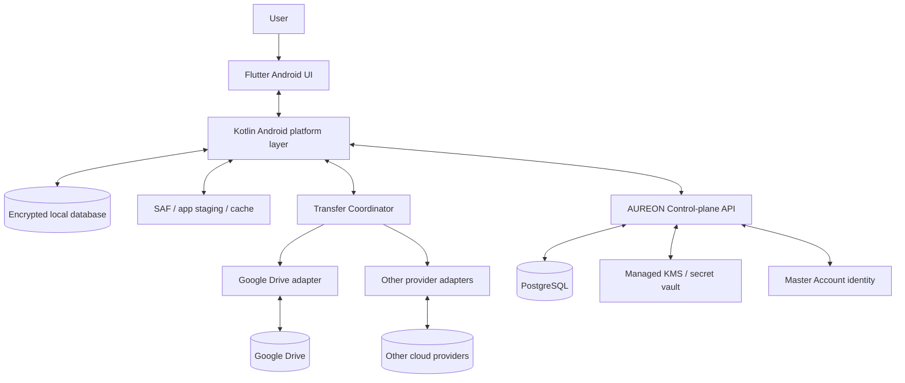

# AUREON — A0 Engineering Blueprint

**Document type:** Engineering blueprint / implementation contract  
**Version:** 0.1  
**Date:** 2026-11-07  
**Status:** Proposed baseline; decisions marked Accepted are inherited from the product plan. This document does not claim that any component has been implemented.

Related source of truth: [AUREON Product & Technical Planning](./AUREON-PLAN.md)

---

## 0. Executive decisions

| Area | Baseline decision | Status |
|---|---|---|
| Product sequence | Android first; Windows after Android core is stable | Accepted |
| Android client | Flutter UI + Kotlin native integration | Accepted |
| Transfer architecture | Common Transfer Coordinator + provider-native adapters | Accepted |
| File content path | Direct client-to-provider transfer where supported; backend is control plane | Accepted |
| Default cloud copy | One canonical cloud object per logical file | Accepted |
| Local deletion | Never automatic by default; explicit opt-in plus verified remote copy and OS permission required | Accepted |
| Encryption | Client-side E2E encryption target; backend must not hold content keys | Accepted |
| Backend style | Modular monolith, not microservices at MVP | Proposed |
| Backend language | Kotlin/Ktor is the recommended first candidate to align with Android Kotlin; validate operational and hosting fit before locking | Proposed |
| Primary database | PostgreSQL | Proposed |
| Local Android database | Room (SQLite) through Kotlin data layer; Flutter accesses through a typed platform boundary or a selected Flutter database adapter | Proposed |
| API style | Versioned REST + OpenAPI; JSON metadata, binary content stays provider-direct | Proposed |
| Background work | WorkManager for durable scheduling; foreground service only for user-visible long-running transfers where Android policy permits | Accepted direction |
| Download acceleration | Provider-native range/resume first; aria2 is an optional, separately reviewed experiment | Accepted direction |
| Public repository | Source and documentation may be public; secrets and credentials never enter Git | Accepted |

**Important:** The backend-language and local-database choices remain proposals until a small architecture spike validates build complexity, migrations, testing and deployment.

## 1. System context and trust boundaries

### 1.1 Logical architecture



### 1.2 Responsibilities

**Flutter UI**
- Screens, navigation, accessibility, localization, file list presentation and user actions.
- No provider refresh tokens, encryption master keys or raw secret material in widgets, logs or analytics.
- Displays authoritative job state from the local repository, not optimistic assumptions.

**Kotlin Android layer**
- SAF URI access and permission persistence.
- Room/local database access if selected.
- Android Keystore integration.
- WorkManager scheduling, notifications and foreground transfer service where policy-compliant.
- File staging, atomic file operations and platform-specific integrity utilities.
- Narrow, typed bridge to Flutter; no unstructured method-channel sprawl.

**Transfer Coordinator**
- Owns upload/download job lifecycle, queue, concurrency, pause/resume, cancellation, retries, reconciliation, progress and verification.
- Does not implement provider-specific HTTP behavior directly.
- Persists every important state transition before/after external side effects.

**Provider adapter**
- Implements the official provider API and its exact auth, session, chunk, retry, quota, checksum, range and conflict semantics.
- Reports capabilities; the Coordinator must not assume all providers support the same features.

**AUREON backend**
- Master Account identity/session management, device registry, provider-account inventory, encrypted metadata sync, authorization state and audit events.
- Stores provider refresh credentials only if the user explicitly consents and the security model is approved.
- Does not receive plaintext file content or E2E file keys in the normal direct-transfer path.

**Cloud provider**
- Stores the canonical encrypted object and provider metadata.
- Provider quota and policy remain provider-specific; AUREON must not pool quotas or bypass limits.

### 1.3 Trust boundaries

1. Device OS / app sandbox.
2. AUREON client process and local database.
3. AUREON backend and database.
4. Managed KMS/secret vault.
5. Third-party OAuth authorization server.
6. Third-party cloud file API and stored objects.

Treat provider URLs, file names, MIME types, metadata, remote responses and imported files as untrusted input. Validate sizes, paths, MIME claims, identifiers and response structure.

## 2. Recommended application structure

### 2.1 Android repository layout

Proposed structure (adapt to the actual Flutter scaffold after repository inspection):

```text
app/
  lib/
    app/                 # app bootstrap, router, dependency setup
    core/                # errors, result types, logging redaction, config
    design_system/       # theme, typography, components
    features/
      auth/
      home/
      files/
      transfers/
      accounts/
      settings/
      storage_guardian/
    data/
      api/
      local/
      repositories/
    domain/
      models/
      use_cases/
  android/
    app/src/main/kotlin/.../
      platform/
      storage/
      security/
      background/
      transfers/
```

Use feature-first boundaries and dependency inversion. UI must not call provider SDKs or database tables directly. A feature calls a use case/repository; the repository coordinates local state and backend metadata.

### 2.2 Core domain interfaces

Conceptual interfaces, not final source code:

- `TransferCoordinator.enqueueUpload(source, targetPolicy)`
- `TransferCoordinator.enqueueDownload(fileId, destination)`
- `TransferCoordinator.pause(jobId)`
- `TransferCoordinator.resume(jobId)`
- `TransferCoordinator.cancel(jobId)`
- `TransferCoordinator.observe(jobId)`
- `ProviderAdapter.capabilities()`
- `ProviderAdapter.createUploadSession(...)`
- `ProviderAdapter.queryUploadSession(...)`
- `ProviderAdapter.uploadPart(...)`
- `ProviderAdapter.finalizeUpload(...)`
- `ProviderAdapter.reconcileRemoteObject(...)`
- `ProviderAdapter.downloadRange(...)`
- `ProviderAdapter.verifyRemoteObject(...)`

Every operation returns typed outcomes: success, retryable failure, permanent failure, auth required, quota exceeded, session expired, conflict, unsupported capability or verification failure. Avoid swallowing provider errors into generic "failed" states.

## 3. Backend architecture

### 3.1 MVP deployment shape

Start with a **modular monolith**:
- One API service with clear internal modules.
- One PostgreSQL database.
- Database-backed job/outbox records for reliable metadata events.
- Managed KMS or secret manager for server-side OAuth credential encryption.
- Object bytes remain in provider storage; no AUREON object-storage relay in the default design.

Do not introduce Kubernetes, microservices, Kafka or Redis at the start without measured need. A single service plus PostgreSQL is easier to operate, test, back up and secure for an early product.

### 3.2 Backend modules

1. Identity: Master Account registration, login, session lifecycle.
2. Devices: registration, device metadata, revocation and session binding.
3. Provider Accounts: OAuth connect/callback, encrypted credential vault, refresh/revoke status.
4. File Catalog: logical file records, encrypted metadata envelopes and canonical provider locations.
5. Sync: versioned metadata changes, cursor-based sync and conflict reporting.
6. Security/Audit: sensitive actions, device revocation, credential access events.
7. Policy/Capabilities: provider capability registry and policy-safe routing decisions.

### 3.3 Hosting and operational boundary

Hosting provider, region, domain, email delivery and KMS product are **not selected yet**. Choose only after comparing:
- Bangladesh user latency and provider region options.
- PostgreSQL backup/restore and point-in-time recovery.
- KMS availability, key rotation and access audit.
- Data residency and privacy obligations.
- Monthly baseline cost and scaling cost.
- Deployment rollback and incident access controls.

Never commit deployment credentials. Use GitHub Actions secrets/OIDC where supported and environment-specific secret stores.

## 4. Master Account and device identity

### 4.1 Identity requirements

- AUREON Master Account is distinct from Google/Microsoft/Dropbox accounts.
- New-device sign-in restores the account inventory and encrypted metadata, not necessarily valid provider authorization.
- Provider re-authentication must be a normal, clearly explained state when refresh authorization is expired/revoked or consent is required.
- Users can list and revoke devices.
- Session revocation must take effect server-side and be reflected on the next client sync.
- Account recovery must not silently bypass E2E encryption key recovery.

### 4.2 Authentication recommendation

Evaluate passkeys (WebAuthn/FIDO2) plus a well-designed recovery path. Email verification may be used for account communication and recovery, but email possession alone should not automatically decrypt file content. If password authentication is selected, use a modern password-hashing algorithm such as Argon2id with unique salts and server-side rate limiting; never store plaintext or reversibly encrypted passwords.

### 4.3 Device registration

Each installation receives a random device ID and a device-bound key pair generated using platform-backed secure storage where available. The private key must not be exportable through ordinary app APIs. Device identity supports session binding and revocation; it is not a substitute for user authentication.

## 5. Provider OAuth and credential vault

**Provider scope research:** [Provider OAuth and Permission Matrix](./PROVIDER-OAUTH-MATRIX.md). The matrix is a research-backed proposal; exact scopes remain conditional on the final feature boundary and provider review. [Android native OAuth and credential lifecycle](./ANDROID-NATIVE-OAUTH-AND-CREDENTIAL-LIFECYCLE.md) defines the native authorization, device-held credential baseline, refresh/revocation behavior and required security tests.

### 5.1 OAuth rules

- Use official provider authorization flows and least-privilege scopes.
- Use Authorization Code with PKCE where supported and required for public/native clients.
- Validate state, redirect URI, issuer/audience and nonce where applicable.
- Never request or collect provider passwords, OTPs or recovery codes.
- Handle consent revocation, refresh-token rotation, expiry and provider error responses.
- Do not assume a token will remain valid indefinitely or that every provider grants offline refresh access.

### 5.2 Credential storage decision

Two legitimate models exist:

**Model A — device-held provider authorization:** provider tokens remain on each device. Stronger separation from backend compromise, but a new device may need provider re-authentication.

**Model B — consented backend credential vault:** encrypted refresh tokens are stored server-side using envelope encryption backed by managed KMS, with strict service identity, access logging and rotation. This improves cross-device account restoration but makes backend security more consequential.

**Recommendation:** keep Model B as a proposed capability only after threat-model review, provider terms review and explicit user consent. Do not implement a backend token vault as an invisible default. File-content encryption keys must remain client-controlled and separate from OAuth credentials.

## 6. Database design

Use PostgreSQL for server-side relational metadata. Use migrations from the first schema version. Never rely on application code alone for uniqueness or referential integrity.

**Engineering drafts:** [Relational data model and ER diagram](./DATA-MODEL.md) · [Initial PostgreSQL migration](./migrations/V001__initial_schema.sql). These are proposed A0 artifacts and have not yet been applied to a live database or validated against a running PostgreSQL instance.

### 6.1 Core server tables

| Table | Key fields / purpose |
|---|---|
| `users` | `id`, normalized login identifier, status, created/updated timestamps |
| `user_auth_methods` | user ID, auth method, external subject/public credential reference, status |
| `devices` | device ID, user ID, public key, platform, app version, last seen, revoked timestamp |
| `sessions` | session ID, user ID, device ID, token hash/identifier, expiry, revoked timestamp |
| `provider_accounts` | account ID, user ID, provider type, provider subject, display label, status, capability snapshot |
| `provider_credentials` | account ID, encrypted refresh credential envelope, KMS key version, scopes, expiry/rotation metadata |
| `file_records` | logical file ID, owner ID, encrypted metadata envelope, plaintext metadata only where strictly necessary, current version ID, tombstone/status |
| `file_versions` | version ID, logical file ID, content fingerprint, size, encryption format version, created timestamp |
| `file_locations` | version ID, provider account ID, provider object ID, remote version/ETag, verified status, canonical flag |
| `sync_cursors` | user/device/provider scope, cursor, last successful sync |
| `audit_events` | actor/device, event type, target ID, timestamp, minimal redacted details |
| `idempotency_records` | user ID, operation ID, request hash, result reference, expiry |
| `outbox_events` | durable event ID, event type, payload reference, created/processed timestamps |

### 6.2 Device-local tables

| Table | Purpose |
|---|---|
| `local_files` | SAF URI reference, source fingerprint, size, source permission state |
| `transfer_jobs` | job ID, operation ID, direction, file/version, provider account, state, priority, timestamps |
| `transfer_sessions` | provider session reference/URL encrypted at rest, expiry, acknowledged offset/parts |
| `transfer_parts` | part index/range, expected checksum, acknowledged state, retry count |
| `staging_files` | staging path/reference, reserved bytes, cleanup policy; never evict while active |
| `cache_entries` | file/version, local path, size, last access, pinned/offline flag |
| `verification_records` | expected/observed size and hashes, verification method and outcome |
| `key_envelopes` | versioned wrapped file keys and recovery metadata; never plaintext key material |
| `settings` | user/device settings and schema version |

### 6.3 Integrity constraints

- Unique `users.normalized_login_identifier` where applicable.
- Unique provider subject per user/provider where provider semantics permit.
- Unique `transfer_jobs.operation_id` per user/device scope.
- Unique canonical location per file version (partial unique index where supported).
- Foreign keys for owner, device, account, file and version relationships.
- State changes use transactions and optimistic versioning.
- Do not store raw access tokens in general provider-account rows.
- Do not store plaintext encryption keys or recovery secrets in ordinary database columns.

### 6.4 Metadata privacy

File names, folder names, MIME type, sizes and folder hierarchy can be sensitive. E2E privacy means encrypting sensitive metadata where practical. The product must explicitly document which metadata is visible to AUREON backend and which remains client-only. Search over encrypted names may require client-side indexing or a carefully threat-modeled searchable scheme; do not quietly weaken privacy for convenience.

## 7. API contract (initial draft)

**Machine-readable contract:** [OpenAPI v1 draft](./openapi/v1.yaml). The YAML file is the evolving API schema; this section explains the architectural intent and constraints. The server URL is a placeholder until hosting is selected.

Base path: `/api/v1`. JSON over HTTPS. Use OpenAPI as the contract source. All authenticated requests are bound to the user and device; clients cannot choose another user's IDs.

### 7.1 Identity and devices

- `POST /auth/register`
- `POST /auth/session`
- `POST /auth/session/refresh`
- `DELETE /auth/session`
- `GET /me`
- `GET /devices`
- `POST /devices/register`
- `DELETE /devices/{deviceId}`

### 7.2 Provider accounts

- `GET /providers` — supported provider catalog and capability summary.
- `POST /provider-accounts/{provider}/oauth/start` — create OAuth state/PKCE transaction.
- `POST /provider-accounts/{provider}/oauth/callback` — validate callback and bind account.
- `GET /provider-accounts`
- `GET /provider-accounts/{accountId}`
- `POST /provider-accounts/{accountId}/refresh-status`
- `DELETE /provider-accounts/{accountId}`

OAuth callback mechanics may be browser/deep-link based and must follow each provider's registered redirect rules; endpoint names are illustrative until the flow is selected.

### 7.3 File catalog and sync

- `GET /files` — cursor pagination; return encrypted metadata envelopes or only approved visible fields.
- `GET /files/{fileId}`
- `POST /files` — create logical file metadata record with idempotency key.
- `PATCH /files/{fileId}` — versioned metadata update.
- `DELETE /files/{fileId}` — tombstone request, not implicit remote deletion.
- `GET /sync/changes?cursor=...`
- `POST /sync/ack`

### 7.4 Transfer coordination metadata

The client talks directly to provider APIs for file bytes where supported. The backend may coordinate metadata and policy:
- `POST /transfers/intent` — register operation ID, direction, file/version and target policy.
- `POST /transfers/{jobId}/checkpoint` — store non-secret progress summary if cross-device recovery is required.
- `POST /transfers/{jobId}/complete` — submit provider object reference and verification summary.
- `POST /transfers/{jobId}/reconcile` — reconcile ambiguous completion or duplicate candidates.
- `POST /transfers/{jobId}/cancel`

Do not expose a generic backend file-proxy endpoint in the MVP. Never put provider tokens or upload-session secrets in URLs, analytics or ordinary API logs.

### 7.5 API standards

- Consistent error envelope: stable machine code, safe human message, retryability, correlation ID.
- Pagination cursors, bounded page sizes and rate limits.
- Idempotency keys for mutation endpoints.
- ETags/version fields for optimistic concurrency.
- UTC timestamps in ISO 8601.
- Request validation and schema versioning.
- OpenAPI-generated client models where useful; do not let generated models leak into domain logic.

## 8. Transfer Coordinator contract

### 8.1 Core job record

Every job persists:
- AUREON job ID and operation ID.
- Direction (upload/download).
- Logical file/version ID.
- Provider/account and remote object/session references.
- Source snapshot identity and expected byte length.
- Encryption format/version and ciphertext fingerprint where applicable.
- Provider-acknowledged offset or part map.
- State, retry classification, attempt count and next retry time.
- Created/updated timestamps and last error code.

### 8.2 Upload algorithm

1. Validate URI permission, readable source, file size and free staging space.
2. Create stable snapshot/staging copy if source cannot be guaranteed immutable.
3. Compute source fingerprint; detect changes before finalization.
4. Create durable operation ID and local job transactionally.
5. Select a provider/account only under provider policy and available quota.
6. Encrypt into staged ciphertext when E2E encryption is enabled; persist wrapped key metadata safely.
7. Create or resume provider-native resumable session.
8. Upload provider-compliant chunks; persist acknowledgements.
9. On ambiguous timeout, query session/remote object before retrying or creating a new session.
10. Finalize once from the Coordinator's perspective; reconcile uncertain response.
11. Verify remote size/hash/read-back according to provider capability.
12. Atomically persist canonical FileLocation and mark verified.
13. Preserve source by default. Cleanup requires explicit opt-in, verified copy, recoverable encryption metadata and OS deletion permission.

### 8.3 Duplicate prevention

Network delivery is not exactly-once. Design for idempotent operations and reconciliation:
- Unique operation ID created before network side effects.
- Provider session identity persisted and reused.
- Idempotency/precondition support used where provider offers it.
- On uncertain finalization, query session and remote metadata before retry.
- Remote object ID recorded with uniqueness constraints.
- Same logical operation cannot create multiple canonical file locations.
- If provider lacks idempotency guarantees, detect duplicate candidates and surface repair state rather than silently hiding them.

### 8.4 Download algorithm

1. Resolve canonical location and current remote version/validator.
2. Check free destination/staging space.
3. Download to a temporary file.
4. Use byte ranges only if supported and validator-backed; otherwise single-stream resume.
5. Persist progress and retry state.
6. On resume, confirm remote version has not changed.
7. Verify expected size and cryptographic checksum where available.
8. Decrypt to a temporary destination if applicable.
9. Atomically promote to final destination where supported.
10. Mark complete only after verification.

### 8.5 Error classification

Retryable: transient network failure, 5xx, throttling, temporary DNS/TLS failure, recoverable interruption.

Action required: re-authentication, permission revoked, user-selected destination unavailable, recovery key needed.

Permanent until user changes something: invalid request, unsupported file operation, policy restriction, insufficient quota, unsupported checksum requirement.

Do not infinite-retry permanent failures. Honor provider Retry-After and use bounded exponential backoff with jitter.

## 9. Encryption and key hierarchy (design proposal)

Target: client-side E2E encryption. This section requires a dedicated cryptographic review before implementation.

- Generate a random data-encryption key (DEK) per file version.
- Encrypt file bytes with an authenticated mode such as AES-256-GCM; nonce uniqueness is mandatory for every key.
- Wrap the DEK using a user-controlled key hierarchy; device protection uses Android Keystore.
- Recovery design must let a newly authorized device regain access without sending plaintext content keys to the backend.
- Store algorithm identifiers, format version, nonce, authentication tag handling and wrapped-key metadata in a versioned envelope.
- Use independent random nonces and cryptographically secure random generation.
- Define large-file streaming encryption carefully: per-chunk authenticated encryption with unique nonces and authenticated ordering/manifest, or a vetted streaming construction. Do not improvise chunk crypto.
- Verify ciphertext before decryption and authenticate each encrypted chunk before exposing plaintext.
- Key rotation and file re-encryption must be separate workflows with rollback protection.
- No custom cryptography. Use maintained, audited libraries and test vectors.

Threats to model: lost/stolen unlocked device, rooted device, malicious app, backend compromise, OAuth token theft, provider account compromise, malicious file/metadata, replay, rollback, key loss, compromised dependency/build pipeline and accidental logs.

## 10. Android storage and background execution

- Use SAF for user-selected content and persist URI grants when supported.
- Use app-private staging for temporary upload/download bytes; do not assume arbitrary filesystem paths.
- Check available space before staging; reserve a safety margin.
- WorkManager for durable deferrable jobs and retry scheduling.
- Foreground service only for ongoing user-noticeable transfers where Android version policy allows; show clear notification and stop when done.
- Handle process death, reboot, Doze, battery restrictions, network changes and OEM-specific behavior.
- Do not promise an uninterrupted transfer if the OS or user stops the app.
- No access to other apps' private data without legitimate platform support; no silent deletion.

## 11. Observability and privacy-safe diagnostics

Record structured events:
- Job created/state changed/retried/paused/resumed/completed.
- Provider error category and HTTP status class.
- Bytes acknowledged, duration, effective throughput and retry count.
- Verification method/result.
- App/OS version and coarse network type only when justified.

Never log:
- Access/refresh tokens, OAuth codes, session URLs, encryption keys, recovery phrases.
- File contents or full private file names/paths by default.
- Raw request/response bodies that may contain secrets.

Provide an exportable diagnostic report with redaction and user consent. Correlation IDs must not expose account secrets.

## 12. Testing strategy and release gates

### Unit tests
- Domain state transitions and illegal-transition rejection.
- Idempotency/reconciliation logic.
- Provider capability negotiation.
- Retry classification/backoff.
- Chunk range calculations and offset accounting.
- Encryption envelope parsing and cryptographic test vectors.

### Integration tests
- OAuth connect, refresh, revoke, expiry and re-auth.
- Upload/download against provider test accounts.
- Provider session expiry and resume.
- Rate limits and Retry-After.
- Remote object reconciliation after lost response.
- Database migration and rollback behavior.

### Fault injection
- Kill process during every upload/download phase.
- Reboot, airplane mode, network handoff and DNS failure.
- Server accepts bytes but response is lost.
- Finalize succeeds but response is lost.
- Corrupt/truncate a chunk.
- Change source file while upload is running.
- Remote object changes during a resumed download.
- Low storage, no permission, account full and revoked token.
- Wrong recovery key and interrupted decrypt.

### Release blockers
- Any silent corruption or undetected truncation.
- Duplicate canonical object from a repeated logical operation.
- Source deletion before remote verification and explicit user opt-in.
- Lost upload session that silently restarts as a duplicate.
- Plaintext keys/tokens in logs or unencrypted persistent storage.
- A restore flow that claims success without proving file decryptability.
- A job that is marked complete before final verification.

Performance should be benchmarked on representative low/mid-range Android devices and constrained mobile networks. No fixed speed guarantee until measurements exist.

## 13. CI, repository and release engineering

- Keep repository public if desired; public source does not imply public secrets.
- Add secret scanning and dependency/license scanning.
- Pin or constrain toolchain versions; update deliberately.
- Run formatting, static analysis, unit tests and Android build in CI.
- Add integration tests that can run with mocked providers; real provider tests require dedicated test accounts/secrets stored outside Git.
- Protect release signing material in GitHub Actions secrets or an external signing service.
- Record commit SHA, workflow run, artifact checksum and test evidence for each release.
- Do not alter unrelated workflow configuration while building A0.
- Keep third-party license notices and source attribution for every adopted library.

## 14. Open decisions before production implementation

These are not blockers for documentation, but must be resolved before the relevant code ships:

1. Backend host, deployment region, domain and email provider.
2. Master Account sign-in and recovery method (passkeys/password/email recovery).
3. Whether backend-held provider refresh tokens are enabled; exact consent and threat model.
4. Exact Google Drive OAuth scopes and verification requirements.
5. Minimum Android API and supported device matrix.
6. Flutter/Kotlin boundary and Room vs another local persistence adapter.
7. Backend Ktor validation spike and final framework choice.
8. Encryption key hierarchy, streaming format, recovery and key rotation protocol.
9. File metadata visibility to backend and encrypted search strategy.
10. Provider-specific checksum/read-back guarantees and verification level.
11. Transfer staging reserve and cache defaults.
12. Privacy policy, terms, retention, account deletion and incident response.

## 15. A0 exit criteria

A0 is complete only when:
- Architecture and trust boundaries are reviewed.
- Database entities and uniqueness constraints are agreed.
- API contract has an OpenAPI draft.
- OAuth and credential-storage model is selected for the first provider.
- Encryption/key-recovery design has a reviewable protocol and test vectors.
- Transfer Coordinator state machine and idempotency behavior are testable.
- Android minimum API and supported test devices are chosen.
- Hosting/cost/security decisions are documented.
- A1 backlog is split into small, verifiable issues.

Until these are met, A0 is **in progress**. This document is the first blueprint draft, not a declaration that all A0 decisions are closed.

## 16. Change log

### 2026-11-07 — Initial A0 blueprint
- Defined trust boundaries and modular-monolith backend direction.
- Proposed Kotlin/Ktor and PostgreSQL for evaluation; not yet locked.
- Drafted backend/local data entities and API surface.
- Defined OAuth, credential-vault tradeoffs and E2E key separation.
- Defined Transfer Coordinator interfaces, upload/download algorithms and duplicate reconciliation.
- Added threat model, Android background/storage rules, test gates and A0 exit criteria.

## 17. Maintenance rules

1. Mark each decision Proposed, Accepted or Verified.
2. Record the reason and date for material changes.
3. Never label planned code as implemented.
4. Every data-loss/security requirement must map to an automated test.
5. Every provider adapter must document the exact API capability and policy constraints it relies on.
6. Revisit this blueprint when provider APIs, Android platform rules or security assumptions change.
