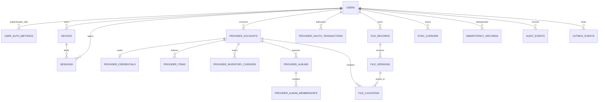

# AUREON — Server Data Model (A0 Draft)

**Version:** 0.2 · **Date:** 2026-11-07 · **Status:** Proposed baseline, not production-approved

This document defines the PostgreSQL control-plane model. It stores account, device, provider-link, encrypted provider-credential envelopes, provider inventory metadata, file catalog, transfer coordination and audit metadata. It does **not** store file bytes, plaintext OAuth credentials or plaintext file-content encryption keys.

## Design principles

1. Every user-owned row is scoped to `user_id`; authorization derives the owner from the authenticated session, never a client-supplied owner ID.
2. Use UUID primary keys generated by the application or `gen_random_uuid()`; IDs are identifiers, not secrets.
3. Use UTC `timestamptz` for instants and explicit constrained state columns.
4. Preserve referential integrity with restrictive deletion. Account deletion is a reviewed lifecycle workflow, not a destructive cascade.
5. Sensitive file/folder metadata is an opaque client-encrypted envelope where practical. Provider IDs, MIME types, parent relationships and operational metadata may remain visible and must be disclosed.
6. Cross-device provider restoration requires a user-consented backend credential vault. The vault stores authenticated encrypted envelopes wrapped by managed KMS/HSM; no plaintext token columns.
7. Provider OAuth credentials and E2E content keys are separate trust domains. Backend vault access never grants content decryption.
8. Idempotency is scoped by user + operation key and bound to a canonical request hash.
9. File-location canonicality is enforced per file version by a partial unique index.
10. Catalog tombstones do not authorize remote-object or local-original deletion.
11. State transitions require service-layer validation and transactions; CHECK constraints provide a second line of defense.

## Entity relationship overview

## Table contracts

| Table | Purpose | Important constraints |
|---|---|---|
| `users` | Master Account lifecycle | unique normalized login identifier when present |
| `user_auth_methods` | Passkey or external identity references | unique issuer + subject; credential public key only |
| `devices` | Registered app installations | unique user + device public-key fingerprint |
| `sessions` | Revocable device-bound sessions | store token hash, never bearer token |
| `provider_accounts` | Linked cloud accounts | unique provider + provider subject per user |
| `provider_credentials` | User-consented encrypted OAuth refresh-token vault | KMS-wrapped envelope, versioned, refresh lease/CAS |
| `provider_oauth_transactions` | Short-lived OAuth state and PKCE transaction | state hash, encrypted transient verifier, one-time consume, TTL |
| `provider_inventory_cursors` | Account-wide initial scan and incremental sync progress | opaque encrypted page/change cursors, resumable |
| `provider_items` | Metadata-first Drive/file-provider inventory | stable provider ID, real parent ID, item kind, encrypted metadata |
| `provider_albums` | Provider-native album objects where API exposes them | separate from filesystem folders |
| `provider_album_memberships` | Provider-exposed album/media membership | no fabricated membership or folder semantics |
| `file_records` | Logical AUREON file catalog entry | tombstone; encrypted metadata envelope |
| `file_versions` | Immutable content/version facts | unique version number per file; ciphertext fingerprint |
| `file_locations` | Provider object locations | unique provider object per account; one canonical location per version |
| `sync_cursors` | Device/account sync progress | unique user + device + provider account + scope |
| `idempotency_records` | Safe request replay/reconciliation | unique user + operation key; request hash mismatch is conflict |
| `audit_events` | Security and lifecycle audit | append-only at application level; redacted details |
| `outbox_events` | Reliable asynchronous event dispatch | lease/attempt tracking; payload references, never secrets |

## Provider inventory semantics

- Initial inventory is metadata-first, paginated, resumable and account-scoped. Do not download file bytes merely to index a file.
- Store the provider's actual parent relationship. Do not flatten nested folders or move, rename or delete originals.
- Derived categories (Documents, Images, Videos, Audio, Archives, PDFs, Spreadsheets, Presentations, Code, Other) are virtual AUREON views based on provider MIME type/metadata. They do not change the provider hierarchy.
- Model folders, files, shortcuts, shared items and trashed items explicitly. A shortcut is not silently treated as a duplicate physical file. Preserve provider IDs and target IDs where available.
- Orphaned/missing parents remain visible as unresolved hierarchy states; do not invent a parent path.
- Use provider change tokens/page tokens as opaque values. Encrypt cursor envelopes at rest and never place them in logs.
- Google Photos albums are provider-native albums, not Drive-like folders. Store album membership only where the supported API actually exposes it. Picker-selected existing media and app-created Library API media must retain their distinct provenance. Do not promise unrestricted full-library crawling.
- Inventory records are provider mirrors/indexes, not permission to modify or delete provider objects.

## Ownership and isolation

- Use composite foreign keys such as `(user_id, provider_account_id)` and `(user_id, device_id)` to prevent cross-user references.
- Every read/mutation query includes authenticated `user_id`, even when UUIDs are globally unique.
- Integration tests attempt cross-user access for every repository method.
- Credential broker decrypt permissions are separate from ordinary API and inventory services.
- New credential rows default to reauth-required. A credential may become active only after explicit user consent is recorded; migration must never silently activate legacy or unconsented credentials.

## File versions and canonical locations

- A version represents immutable content bytes (or immutable ciphertext bytes when client-side encryption is enabled).
- `content_fingerprint_sha256` is SHA-256 of the exact byte representation defined by the encryption protocol. Provider ETags are not assumed to be SHA-256.
- A location becomes canonical only after successful verification and server-side validation.
- Do not remove an older verified location during migration until its replacement is verified and canonical state is committed.
- No remote-delete queue is included. Remote deletion requires a separately reviewed, explicit user-authorized workflow.

## Credential vault invariants

- The database stores only a versioned authenticated-encryption envelope, algorithm identifier, KMS key reference/version, granted scopes, timestamps and concurrency metadata.
- Envelope payload includes the wrapped data key, nonce, ciphertext and authentication tag according to a versioned format. The database never stores KMS key material or plaintext access/refresh tokens.
- KMS key references are identifiers, not secrets. Access is granted only to a dedicated credential-broker workload identity.
- Refresh tokens remain exclusively in the backend vault. A short-lived access token may be issued over TLS to the authenticated native provider adapter for direct provider API operations; it is memory-only, never logged or persisted, and never exposed to Flutter UI. Refresh-token rotation is an atomic compare-and-swap on credential version.
- A refresh lease prevents concurrent use of rotating credentials. A stale lease holder cannot overwrite a newer version.
- OAuth state is stored as a hash. Any server-held PKCE verifier is encrypted, short-lived and deleted after transaction consumption/expiry. Raw authorization codes are never persisted.
- Every decrypt/refresh/rotate/revoke operation emits a redacted audit event. Outbox and audit payloads never contain secrets.
- If KMS is unavailable, fail closed. Never fall back to plaintext, delete credentials, or mark provider account disconnected.

## Transfers, idempotency and deletion

- Device-local storage remains authoritative for local transfer execution. Server idempotency and outbox coordinate cross-device operations and durable events.
- Persist the operation key before provider side effects. Same key + same request hash returns the original result; same key + different hash is HTTP 409.
- Never persist raw provider tokens or resumable upload session URLs in generic event payloads.
- Ambiguous completion triggers provider session/metadata reconciliation, not blind duplicate creation.
- Prefer RESTRICT foreign keys. User/account erasure is staged, audited and reviewed.
- A file catalog tombstone does not delete provider objects or local originals. Automatic local-original deletion remains disabled unless the user explicitly opts in after verification and platform permission.

## Migrations

- [V001 initial schema](./migrations/V001__initial_schema.sql): identity, devices, provider accounts, base vault envelope, catalog, sync and coordination.
- [V002 vault and provider inventory](./migrations/V002__vault-and-provider-inventory.sql): credential-envelope lifecycle metadata, OAuth transactions, account-wide inventory cursors, provider items and provider-native albums.
- V001 is immutable; future changes are additive migrations. Both migrations must be applied in order and tested on PostgreSQL 16 through CI before production use. No live database is provisioned.

## Open decisions

- Master Account sign-in/recovery method (passkey-first, password or external identity).
- Exact KMS/HSM vendor, region, envelope library/format, rotation and destruction semantics.
- OAuth callback mode per provider and provider client registration/verification.
- Google Drive scope selection, verification and restricted-scope security assessment.
- Provider-specific metadata visibility and retention; encrypted metadata search strategy.
- Whether shared drives, shared folders, shortcuts and trashed objects are in first-provider scope.
- Audit/outbox retention, partitioning and deletion/legal workflow.
- Provider-specific album/media membership capabilities and Photos Picker UX.
- Migration runner and rollback/forward-fix policy.

