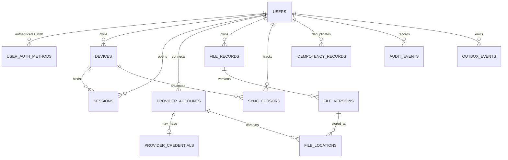

# AUREON — Server Data Model (A0 Draft)

**Version:** 0.1 · **Date:** 2026-11-07 · **Status:** Proposed baseline, not production-approved

This document defines the first PostgreSQL relational model for the AUREON control plane. It stores account, device, provider-link, file-catalog, transfer coordination and audit metadata. It does **not** store file bytes or plaintext file-content encryption keys.

## Design principles

1. Every user-owned row is scoped to `user_id`; authorization must derive the owner from the authenticated session, never trust a client-supplied owner ID.
2. Use UUID primary keys generated by the application or `gen_random_uuid()`; IDs are identifiers, not secrets.
3. Use UTC `timestamptz` for instants. Use explicit status columns with constrained values.
4. Preserve referential integrity with foreign keys and restrictive deletion. Account deletion is a reviewed lifecycle workflow, not a cascade that can silently destroy the only known-good copy.
5. Sensitive metadata is stored as an opaque client-encrypted envelope where practical. Provider object IDs and operational metadata remain visible to the control plane and must be disclosed in the privacy model.
6. Provider credentials, if backend vaulting is later approved, are encrypted envelopes with KMS key version metadata. No plaintext access/refresh tokens.
7. Idempotency is scoped by user + operation key and bound to a canonical request hash.
8. File-location canonicality is enforced per file version by a partial unique index. A logical file may have historical versions; a version may have multiple locations, but at most one canonical location.
9. Use soft tombstones for catalog deletion. This schema does not authorize remote-object deletion or local-original deletion.
10. State transitions require service-layer validation and transactions; CHECK constraints provide a second line of defense.

## Entity relationship overview

## Table contracts

| Table | Purpose | Important constraints |
|---|---|---|
| `users` | Master Account lifecycle | unique normalized login identifier when present |
| `user_auth_methods` | Passkey or external identity references | unique issuer + subject; credential public key only |
| `devices` | Registered app installations | unique user + device public-key fingerprint |
| `sessions` | Revocable device-bound sessions | store token hash, never bearer token |
| `provider_accounts` | Linked cloud accounts | unique provider + provider subject per user |
| `provider_credentials` | Optional encrypted OAuth credential vault | one row per account; backend vault is disabled until separately approved |
| `file_records` | Logical file catalog entry | tombstone; encrypted metadata envelope |
| `file_versions` | Immutable content/version facts | unique version number per file; ciphertext fingerprint |
| `file_locations` | Provider object locations | unique provider object per account; one canonical location per version |
| `sync_cursors` | Provider/device sync progress | unique user + device + provider account |
| `idempotency_records` | Safe request replay/reconciliation | unique user + operation key; request hash mismatch is conflict |
| `audit_events` | Security and lifecycle audit | append-only at application level; redacted details |
| `outbox_events` | Reliable asynchronous event dispatch | lease/attempt tracking; payload must contain references, not secrets |

## Important implementation rules

### Ownership and cross-user isolation
- Use composite foreign keys such as `(user_id, file_id)` and `(user_id, provider_account_id)` to prevent accidentally connecting records belonging to different users.
- Every read and mutation query must include authenticated `user_id`, even when the UUID is globally unique.
- Add integration tests that attempt cross-user access for every repository method.

### File versions and canonical locations
- A version represents immutable content bytes (or immutable ciphertext bytes when client-side encryption is enabled).
- `content_fingerprint_sha256` is the SHA-256 of the exact byte representation defined by the encryption protocol. Do not confuse provider ETags with SHA-256.
- A location becomes canonical only after the client submits a successful verification result and the server validates the transition.
- Do not remove an older verified location during migration until the replacement is verified and canonical state is committed.
- This model intentionally does not include a remote-delete queue. Remote deletion requires a separately reviewed, explicit user-authorized workflow.

### Transfers and idempotency
- The device-local database remains authoritative for local transfer execution state. Server-side `idempotency_records` and `outbox_events` coordinate cross-device operations and durable events.
- Persist the operation key before provider side effects. Repeated requests with the same key and same request hash return the original result; same key with a different hash returns HTTP 409.
- Do not persist resumable upload session URLs or raw provider tokens in generic event payloads. If a session reference must be synchronized, encrypt it for the owning device or store a separately protected credential envelope.
- An ambiguous completion response must trigger provider metadata/session reconciliation, not blind creation of a second object.

### Retention and deletion
- Prefer `RESTRICT` foreign keys. User/account erasure must be a deliberate, staged workflow with retention, legal and provider-specific checks.
- A file catalog tombstone does not delete provider objects or local originals.
- Audit and outbox retention periods are policy decisions still open in A0.

## Migration

Initial PostgreSQL migration: [V001__initial_schema.sql](./migrations/V001__initial_schema.sql).

The migration is a reviewable baseline. It must be tested against the selected PostgreSQL major version and migration runner before production use. No live database has been provisioned by this document.

## Open decisions

- Whether login identifier is email, passkey-first, or another account identity model.
- Whether backend-held provider refresh credentials are enabled at all.
- Whether provider capability snapshots need normalized child tables.
- Retention/partitioning for audit and outbox tables at expected scale.
- Whether sync cursors are provider-account scoped only or need per-resource scopes.
- Whether file metadata envelope versioning belongs on `file_records` or a separate metadata-version table.
- Exact KMS provider, envelope format, rotation and deletion semantics.
